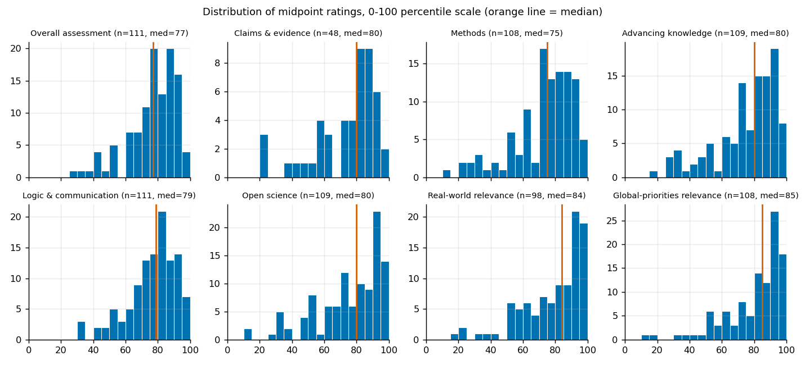
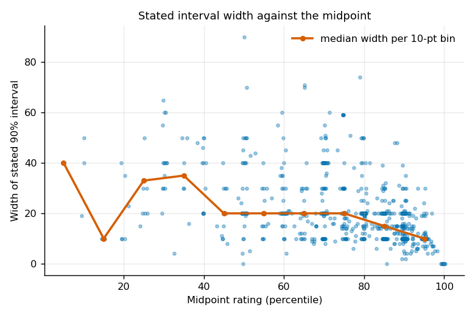
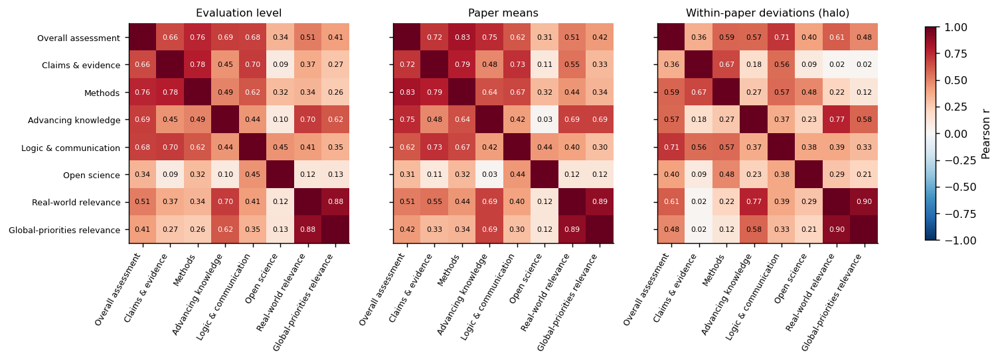
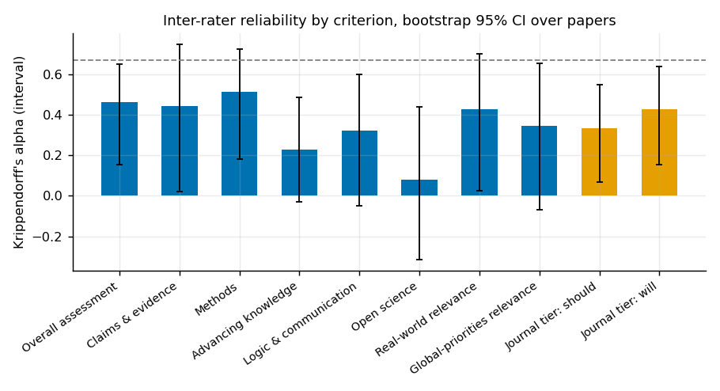
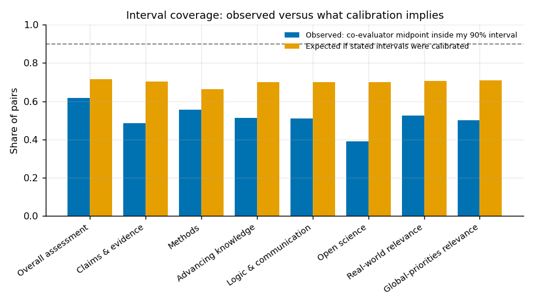
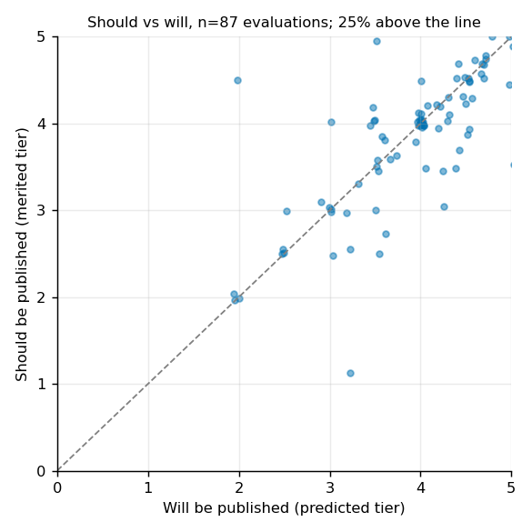
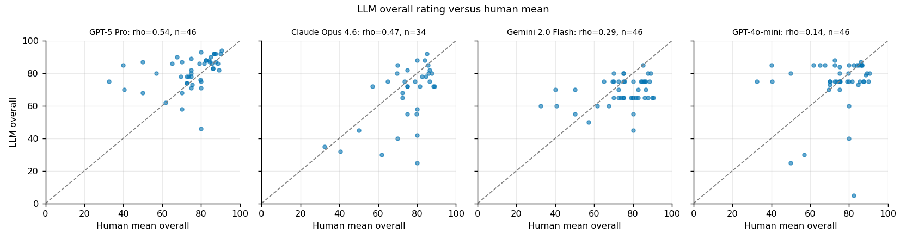

::: callout-warning
## Draft
Generated by `code/analyze_ratings_quality.py`; tables and figures under `results/` are its outputs. Prose was drafted with Claude Code and has not yet been reviewed. Remove `draft: true` to publish.
:::

*Reanalysis, 16 October 2026. Prepared with Claude Code (Fable 5.1) for David Reinstein. Code: `code/analyze_ratings_quality.py` in the `unjournaldata` repository; all tables and figures regenerate from the public data export plus two optional supplements (the LLM-evaluation repository and the private database, used only for aggregate evaluator-level checks). No evaluator is identified anywhere in this report.*

## Headline findings

1. **The data.** 61 evaluated papers, 114 evaluations, 1,018 numeric ratings. Fifty papers have two or more evaluations, so most reliability and calibration results rest on about 45 to 48 paper pairs. The public export now uses per-paper evaluator labels, which is right for privacy but means cross-paper evaluator effects can only be studied on the private side.

2. **A data-pipeline gap.** The three evaluation packages published on PubPub since February 2026 (the scanner-data price-elasticity paper, the Yellow Vests independent evaluation, and the existential-risk technical report) have no rows in the Coda ratings table or the public export. The existential-risk evaluation sits in the new form's `form_submissions` table on Linode as `pending_review` since July. I added its seven ratings by hand for this analysis. The other two could not be read (PubPub's bot protection blocks automated fetches).

3. **The published 2025 post contains an error.** Its conclusions say evaluators "consistently judge papers as meriting higher-tier publication than they predict", "statistically significant (p < 0.001)". Its own test section reports a mean difference of -0.03 tiers, p = 0.63. The hard-coded sentence was never updated. I changed the source so the sentence is computed; it will render correctly at the next publish. To be clear, the form still asks both questions separately; the point is about the answers. On average, evaluators' "should" and "will" tiers are nearly the same number, and 43% of evaluations give exactly the same midpoint. That share is 61% for rows entered in 2024 (mostly older evaluations transferred from PubPub) and 24% for 2025 entries, so part of the overlap may be a transfer artifact; this is being checked against the published evaluations.

4. **Scale use is top-heavy.** On a scale that is meant to be a percentile of "serious research in the same area", 90% of overall ratings are above 50 and 47% are 80 or above. Relevance criteria are higher still (medians 84 to 85). Some of this is selection; The Unjournal picks promising work. Some is probably leniency and a loose reference class. Ratings heap on multiples of 5 (77%) and 10 (41%), so the effective precision is about five points.

5. **Evaluators disagree a lot, and their intervals do not admit it.** Two evaluators of the same paper differ by 12 points on overall assessment on average, 14 on methods, 19 on advancing knowledge and 23 on open science. Their stated 90% intervals have a median half-width of 10. If those intervals were calibrated, a co-evaluator's midpoint would fall inside about 70% of the time; it falls inside 51% of the time. Intervals would need to be roughly 2.5 times wider to match the disagreement we observe. Nearly a quarter of evaluator pairs give intervals that do not overlap at all.

6. **Reliability is moderate for quality, poor for open science.** Krippendorff's alpha (interval) is 0.45 for overall assessment, 0.50 for methods, 0.43 for claims and evidence (18 papers), 0.40 real-world relevance, 0.32 global-priorities relevance, 0.30 logic and communication, 0.22 advancing knowledge, and 0.06 for open science. With two raters, the paper mean reaches a reliability of about 0.6 to 0.7 for overall and methods; five raters would be needed for 0.8. Open science as currently measured is close to noise: evaluators differ by 21 points on it while papers differ by only 6.

7. **Two criteria are redundant and one is doing most of the work.** Real-world relevance and global-priorities relevance correlate at 0.89 within an evaluation (the new form already dropped real-world relevance; the data support that). The overall assessment is predicted (R-squared 0.74) by methods, advancing knowledge and logic; the relevance criteria and open science get roughly zero weight. Evaluators' "overall" is a rigor and contribution judgment, not an importance judgment.

8. **Halo.** When one evaluator is more generous than the co-evaluator on one criterion, they tend to be more generous on all of them (within-paper deviations correlate 0.41 across criteria on average). Part of what the sub-criteria measure is the rater, not the paper.

9. **Anonymous evaluators are harsher.** On papers with one anonymous and one named evaluator, the anonymous one rates about 5 points lower across criteria (102 paper-criterion comparisons, p = 0.009). This could be selection into anonymity or disinhibition; either way, named and anonymous numbers are not on the same scale.

10. **Journal predictions have some validity.** For 13 papers now published in journals I could assign a tier to, the mean predicted tier correlates 0.71 (Spearman) with the realised tier, with a small optimism of 0.2 tiers; 61% of evaluators' intervals covered the outcome. Papers that later landed in top journals had been predicted at 4.1 versus 3.7 for those still unpublished.

11. **LLM ratings.** Consistent with the LLM-evaluation site: GPT-5 Pro's overall rating correlates 0.54 with the human mean (46 papers), and as a stand-in for a second human it agrees with a single human evaluator at least as well as another human does (0.52 versus 0.37 for overall; 0.51 versus 0.42 methods; 0.68 versus 0.48 predicted tier). But it rates 6 points high on average and compresses the scale (SD 10 versus 14 to 15 for humans), so it should be used after standardisation. Open science is where every model disagrees with humans most (GPT-5 Pro and Claude Opus 4.6 rate it 17 to 20 points lower than the evaluators).

## The data



Claims and evidence was introduced in 2025 and appears in 41% of evaluations. Real-world relevance was dropped from the current form. About 11 to 13% of percentile ratings have no interval; journal-tier ratings lack intervals 17 to 21% of the time. A legacy "confidence level" field appears in four rows and can be retired.

Evaluations are 58% anonymous. Ninety-three evaluations are academic-stream and eleven applied-stream (eight unassigned). Evaluation packages were published from 2023 to 2026; the mean overall rating by publication year is flat (76, 75, 75, 70 for 2023 to 2026, the last on seven evaluations) and the median interval width moved from 20 to 15.5 and back.

## 1. The nature of the numbers





Every percentile criterion has a mean between 71 and 78 and a median between 75 and 85. A Kolmogorov-Smirnov test against the uniform distribution the percentile interpretation would imply for a representative sample rejects at any level. Only 2 to 7% of ratings are 30 or below. The two relevance criteria are the most inflated: 37 to 40% of ratings are at or above 90.

Straightlining is rare: 2 of 109 evaluations give the same number on every criterion, 5 have a range of five points or less, and the median within-evaluation range is 25 points. Evaluators do differentiate.

Journal tiers: mean 3.85 on both the should and will questions, about 59% at 4 or above, none at 1 or below. Non-integer answers are common (63%), as the guidelines encourage.

**Intervals.** Of 827 percentile ratings, 8 have an interval that excludes its own midpoint and 11 have zero width (for example "100 [100, 100]"). Fourteen percent of intervals touch 0 or 100. Two-thirds are symmetric about the midpoint; where they are not, the lower tail is usually the longer one (22% versus 12%). The median width is 20 points (10th to 90th percentile: 10 to 40). Widths shrink as midpoints rise: median 30 for midpoints at or below 50, 20 in the 50 to 85 range, and 11 above 85. Part of this is the ceiling, but it also means our most confident intervals sit exactly where the ceiling makes them cheapest to state.





Evaluators do not simply use one width for everything: only 7% of evaluations use a single width across criteria.

## 2. Structure, redundancy and halo



The average off-diagonal correlation between criteria is 0.48 within an evaluation and 0.53 between paper means. A principal-components analysis of the seven classic criteria on paper means puts 56% of the variance on a first component that loads evenly on everything except open science (loading -0.09), 19% on a second component that is mostly open science with logic and communication, and 13% on a third that separates relevance from the rest.



Real-world relevance is 82% predictable from the other criteria, global-priorities relevance 80%, overall 74%, claims 73%. Open science is only 23% predictable, which would be interesting if it were reliable; it is not (see section 4).

Regressing overall on the other six classic criteria (standardised, n = 96, R-squared 0.74) gives weights of 0.42 methods, 0.30 advancing knowledge, 0.28 logic and communication, 0.13 real-world relevance, -0.04 open science and -0.10 global-priorities relevance. Overall is also within a point of the simple mean of the sub-criteria on average, and in only 2% of evaluations is it above the highest sub-criterion.

The third panel of the figure is the halo check: each rating minus the paper's mean on that criterion, correlated across criteria. The average is 0.41. The strongest rater-level co-movements are the two relevance criteria (0.91), overall with logic and communication (0.71), and advancing knowledge with real-world relevance (0.79). Claims and evidence stands apart: a rater's generosity on claims barely co-moves with their generosity on relevance (0.02).

## 3. Inter-rater reliability





Alpha is the interval-metric Krippendorff's alpha over all papers with at least two ratings; the confidence interval is a bootstrap over papers, and it is wide everywhere. ICC(1) is the one-way intraclass correlation, numerically similar; "icc1k" is the reliability of the paper mean with the average number of raters we actually have (about two). "Rater noise SD" is the within-paper standard deviation of ratings; "between-paper SD" is the estimated spread of true paper scores.

Three readings:

- Overall and methods carry a real signal. Rater noise (11 to 13 points) is roughly equal to the spread of papers (10 to 13 points), so a single evaluation tells you about half of what you want to know and the mean of two tells you about two-thirds.
- Advancing knowledge, logic and communication and both relevance criteria carry less: noise is 1.5 to 2 times the spread of papers.
- Open science as rated carries almost none. Papers differ by 6 points; evaluators differ by 21. The bootstrap interval includes zero comfortably.

By era (data-entry year 2024 versus 2025 and later) alpha for overall is 0.47 versus 0.42, so there is no sign the percentile re-framing or the calibration tool changed agreement. The academic stream alone gives 0.37 over 40 papers; the applied stream gives 0.91 but on five papers. By research area, agreement on overall is lowest in the two largest areas, global health (0.16, 13 papers) and development economics (-0.28, 11 papers), and highest in environment (0.69, 6 papers). Small cells, but it is at least not the case that the areas where we have the most practice agree the most.

The prior posts reported alphas of 0.4 to 0.6 and called the measures "moderately reliable". With confidence intervals attached, the honest statement is: overall and methods are moderately reliable, the rest are weakly reliable, and open science is unreliable.

## 4. Calibration of the 90% intervals





The test here is the one the guidelines invite. Each evaluator states a 90% credible interval for the "true" percentile. If both evaluators of a paper were calibrated and independent, one evaluator's midpoint would fall inside the other's interval about 75% of the time under a normal model with equal noise; using each pair's actual stated widths, the implied figure for our data is 70%. The observed figure is 51% overall (62% for overall assessment, 39% for open science). Twenty-three percent of pairs state intervals that do not overlap at all. Scaling every interval by a common factor, they would need to be 2.5 times wider to reach the calibrated benchmark.

A second way to see the same thing: a median half-width of 10 implies an evaluator believes their own error has a standard deviation of about 6 points. The disagreement between evaluators implies a per-rater error standard deviation of 12 (overall) to 21 (open science) points. Evaluators are overconfident by a factor of two to three and a half.



Wider intervals do cover more, so the number means something: evaluators who state 30-point intervals cover 67% of co-evaluator midpoints versus 37% for those at 10 or below. But the gap to the calibrated expectation is about the same at every width. The correlation between an evaluator's own half-width and how far they are from the co-evaluator is only 0.13: there is a little self-knowledge in the intervals, not much.

At the evaluation level, 45% of evaluations cover fewer than half of their co-evaluator's midpoints, 4% cover none, and 8% cover all.

Two caveats run the other way. The "true percentile" is an idealised quantity, and two evaluators can both be right about different things. And if evaluators share information (same seminar, same priors), coverage would be higher than the independence benchmark, not lower; so this is if anything a lower bound on overconfidence.

## 5. Journal-tier questions



Should and will are almost the same number (means 3.82 and 3.86, correlation 0.73, 43% identical midpoints). Identical midpoints are much more common among rows entered in 2024 (61%) than in 2025 (24%), which may partly reflect how older evaluations were transferred; the gap between "should" and "will" may therefore be understated. "Should" correlates 0.77 with the overall assessment; "will" 0.54. So "should" tracks the overall assessment closely, while "will" is the one question with a resolvable answer. The useful quantity is the difference between them (how much evaluators think the journal system will over- or under-reward a paper), which is why both are kept.





The tier assignment for realised journals is my own reading of the guidelines' five tiers and should be checked. On those 13 papers the mean prediction correlates 0.71 with the outcome; the mean error is +0.2 tiers (optimism), the mean absolute error 0.5 tiers; 61% of the 18 evaluator intervals contained the outcome, with the outcome below the interval 28% of the time. The overall assessment alone correlates 0.65 with the realised tier.

## 6. Systematic patterns



In the pooled comparison only claims and evidence differs much by anonymity. The sharper test is within paper: for 102 paper-criterion cells where one evaluator was named and the other anonymous, the anonymous evaluator is 4.8 points lower on average (Wilcoxon p = 0.009).



Research areas differ more on the relevance criteria than on quality: animal welfare papers score 83 on global-priorities relevance and 58 on methods; existential-risk papers score 82 and 64; the economics and welfare catch-all scores 57 and 68.

On the private side, 58 named evaluators appear in the data and only 9 have evaluated two or more papers (5 have three or more; the most is seven). A one-way ANOVA of residuals (rating minus paper mean) across those repeat evaluators gives p = 0.05 for overall, with an estimated evaluator-effect standard deviation of about 5 points against a residual of 9. That is suggestive of stable leniency differences, but it is nine people. Hours spent (n = 33, median 8) and years in field (n = 16) show no relationship with ratings or widths at these sample sizes.

## 7. Consistency with LLM ratings







The first table is the fair comparison: for papers with two human evaluations, how well does the LLM agree with one randomly chosen human, versus how well the other human agrees with that same person? GPT-5 Pro beats a second human on overall, methods, advancing knowledge, global-priorities relevance and both journal-tier questions; Claude Opus 4.6 beats a second human on overall, methods, advancing knowledge and journal tiers; the cheaper models do not. Adding GPT-5 Pro as a third rater lowers Krippendorff's alpha because of its level bias (it rates 6 points high and compresses the scale), while adding Opus raises it slightly (it rates 8 points low with a human-like spread). The second table asks whether a rater reproduces a paper's profile across criteria (which criteria are its strengths); GPT-5 Pro's profiles agree with a single human's (0.30) more than two humans agree with each other (0.18).



Open science is the exception everywhere: the frontier models rate it 17 to 20 points below the evaluators with near-zero rank agreement. Models cannot check data and code availability from a PDF, and evaluators apparently judge it by something else again.

## 8. Which measures are underused or redundant

- **Real-world relevance** is 82% predictable from the other criteria and correlates 0.89 with global-priorities relevance within an evaluation. Dropping it from the form was right.
- **Open science** has no reliability and no loading on the general factor. It should be replaced by a short checklist of verifiable items (data public, code public, pre-registration, materials), scored yes/partly/no, rather than a percentile. The percentile is costing evaluator time and producing noise.
- **Journal tier "should"** correlates 0.77 with overall. Keep the should/will pair: the contrast is the point of the question, and "will" is the one rating that resolves. The overlap in answers suggests the form should explain the distinction more sharply (for example, ask "will" first, then "if journals judged only merit, where should it go?"), rather than dropping either.
- **Claims and evidence** is new, used in 41% of evaluations, reliability comparable to overall on 18 papers, and the least affected by rater halo. Worth keeping and worth making the structured claim assessment more central.
- **Advancing knowledge** and **logic and communication** have weak reliability (0.22, 0.30). Logic and communication is cheap and distinct; advancing knowledge overlaps heavily with overall and the relevance criteria.
- The legacy **confidence_level** field and the duplicate criterion keys in the new form's output (`advancing_knowledge`, `claims_and_evidence`, `global_relevance`, `open_science`) should be canonicalised at import.

## 9. Implications for the evaluation form, platform and reporting

Easy fixes, in rough order of value for effort:

1. **Fix the pipeline first.** Ratings from the new form never reach the ratings table; three published packages are missing. Add the import step (form_submissions to evaluator_ratings to Coda) and canonicalise criterion keys. Until then, the dashboard and this analysis undercount 2026.
2. **Tell evaluators what disagreement looks like.** Next to each slider: "Evaluators of the same paper typically differ by 12 to 20 points on this scale. A 90% interval narrower than plus or minus 10 is rarely justified." Show the empirical distribution of prior ratings for the criterion. This is the single cheapest calibration intervention and costs nothing in evaluator time.
3. **Warn on narrow and degenerate intervals.** The form already enforces lower <= midpoint <= upper. Add a soft warning for widths under 10 and a hard one for zero width, and a note at the top of the scale that an upper bound of 100 is a claim.
4. **Anchor the reference class.** "Serious research in the same area you have encountered in the last three years" lets everyone choose a flattering comparison set. Options: name a concrete set (a working-paper series, a journal's recent accepts), or ask the evaluator to place the paper among three or four named comparison papers, or show them where previous Unjournal ratings sit.
5. **Replace the open-science percentile with a checklist.** See above. It also makes the LLM comparison meaningful for this criterion.
6. **Report two numbers, not one.** Because "overall" is a rigor judgment that ignores relevance, summaries should present overall and global-priorities relevance side by side, not a single composite.
7. **Report ratings to the nearest 5 and intervals that reflect two-rater noise.** Heaping tells us the evaluators' precision; decimals in summaries overstate it. For a paper with two evaluations, the mean has a standard error of about 8 points on overall.
8. **Use an LLM rating as a standardised third signal.** Run a fixed frontier-model rating on every package and report it separately, rank-standardised against the model's own distribution (never pooled raw with humans, because of level bias). On current evidence it is at least as informative as a second human on overall and methods and much cheaper.
9. **Do not mix named and anonymous numbers casually.** Anonymous evaluators are about 5 points harsher on the same paper. If a composite score is reported, either adjust or note the composition.
10. **Repeat evaluators are the route to rater adjustment.** With only nine people having done two or more evaluations there is no way to estimate individual leniency. Inviting the same evaluators back, and recording an evaluator identifier in the private data, would make rater-adjusted scores possible within a year or two.

## 10. Other lessons about eliciting beliefs here

- A 90% interval is the wrong elicitation for most people: it yields plus or minus 10 almost regardless of the question. A 50% interval, or a direct question ("what is the chance the true percentile is above 80?"), is both easier to answer and easier to score.
- Ask for at least one resolvable prediction per evaluation that is not journal placement: citations at three years above a threshold, replication outcome, policy uptake. Journal placement resolves slowly and noisily and already looks informative; adding a second forecast gives a track record per evaluator.
- Order and framing matter: overall is the first question on the form and is well predicted by the sub-criteria, consistent with evaluators forming a global impression first and then filling in parts. Asking the sub-criteria (and the claim assessment) before overall would make the overall a synthesis rather than an anchor. This is testable with a randomised form order.
- Because much of the criterion variance is rater-level halo, the cheapest gain in paper-level information per evaluator-hour is more raters on fewer criteria, not more criteria per rater.

## Caveats

Fifty papers with two raters is small; every alpha has a confidence interval wider than the differences between criteria, so the ranking of criteria is suggestive. Evaluators are not randomly assigned to papers. The "true value" the intervals refer to is not observable; the co-evaluator benchmark assumes independent, unbiased evaluators. Data-entry dates are not evaluation dates (I used the package publication date where Coda has it). The journal-tier assignment is hand-made. The LLM comparison re-uses runs from the LLM-evaluation repository (Jan to Mar 2026 for the frontier models) and its paper mapping; 47 papers match.

## Reproducing

```
python3 code/analyze_ratings_quality.py \
  --extra-ratings website/posts/ratings-reliability-2026/extra_ratings_2026.csv \
  --paper-meta <coda research export> --llm-repo ../llm-uj-research-eval \
  --private-db ../unjournal-database/unjournal_data.db \
  --out website/posts/ratings-reliability-2026/results
```

Tables are written as CSV and Markdown, figures as PNG, every number as `results.json`. Without the optional supplements the script still produces sections 1 to 6 from the public export alone, which is what a scheduled run can do.
